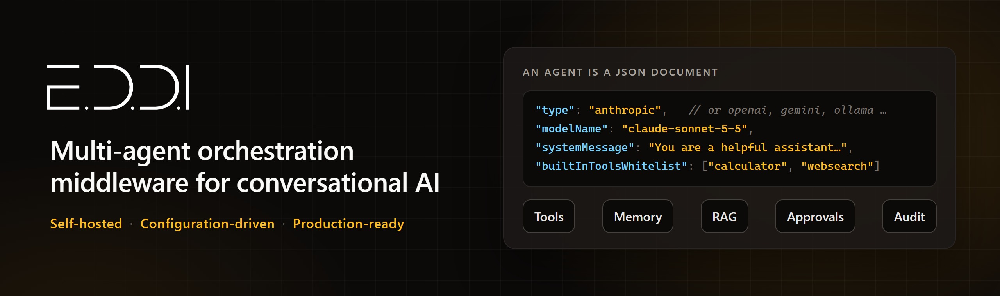
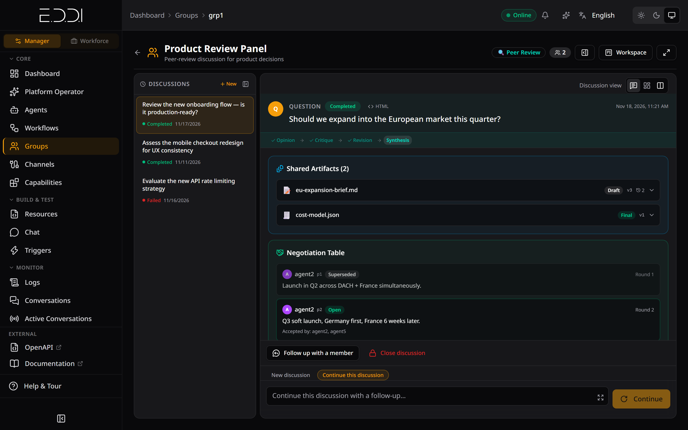
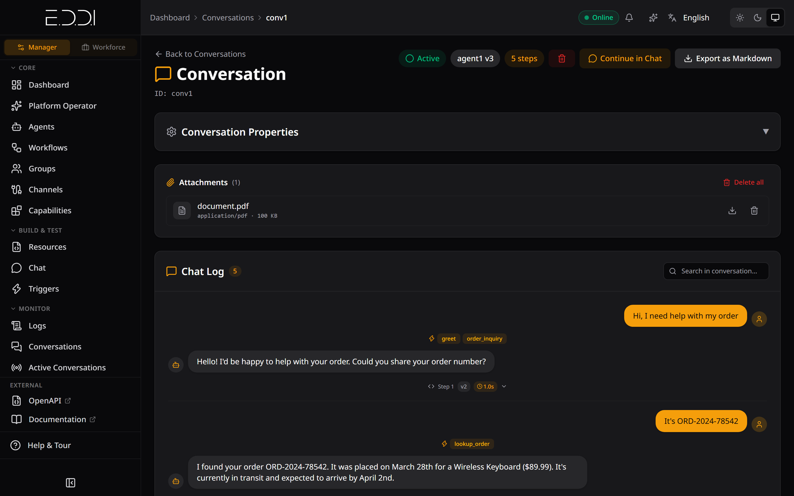
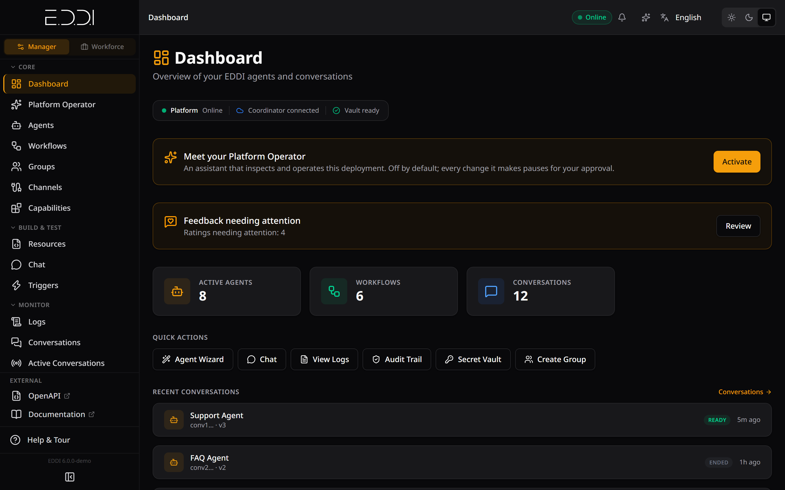

<p align="center">
  
</p>

# EDDI

[](https://github.com/labsai/EDDI/releases) [](https://hub.docker.com/r/labsai/eddi) [](LICENSE) [](https://github.com/labsai/EDDI/actions/workflows/ci.yml) [](https://www.bestpractices.dev/projects/12355) [](https://securityscorecards.dev/viewer/?uri=github.com/labsai/EDDI)

EDDI (E.D.D.I, Enhanced Dialog Driven Interface) is a server you run between your users, your LLMs and your business systems. An agent is a set of versioned JSON configurations, not application code: the engine takes every turn through a deterministic pipeline of rules, API calls and model calls, keeps conversation and user memory, and records what happened. One Docker image serves the REST API, the admin dashboard and the chat UIs. It is Apache-2.0 licensed, ships as a Red Hat-certified container image, and was selected as a UNIDO Trusted Partner for Industrial AI.

[Website](https://eddi.technology/) · [Documentation](https://docs.labs.ai/) · [Quick start](#quick-start) · [Docker Hub](https://hub.docker.com/r/labsai/eddi) · [Discussions](https://github.com/labsai/EDDI/discussions)

## Why EDDI

- **Agent logic is configuration.** Behavior rules, prompts, tools and API calls are versioned JSON documents. Change an agent without redeploying the service, diff it, export it as a ZIP, or sync it to another instance.
- **A strict engine around a creative model.** Rules decide when a model is called and with which tools, and which turns or tool calls wait for [a human's approval](docs/hitl.md). The [project philosophy](docs/project-philosophy.md) puts it as "the engine is strict so the AI can be creative."
- **No dynamic code execution.** There is no `eval` and no script engine; custom logic runs in external MCP servers. Secrets sit in an envelope-encrypted vault, and the built-in tools refuse private and internal addresses (SSRF protection).
- **Open protocols, both directions.** EDDI is an [MCP](docs/mcp-server.md) server (108 tools) and client, speaks [A2A](docs/a2a-protocol.md), and can present deployed agents through an [OpenAI-compatible `/v1` API](docs/open-webui-integration.md).
- **Built for regulated deployments.** An HMAC-secured [audit ledger](docs/audit-ledger.md), GDPR/CCPA erasure and export, and deployment guides for HIPAA and the EU AI Act.
- **Runs where you run.** One command with Docker, or Kubernetes and OpenShift; MongoDB or PostgreSQL; any number of replicas behind a load balancer with NATS JetStream.

EDDI is a service you deploy, not a library you import. If you want agent logic inside your own Python or TypeScript process, a library such as LangGraph, CrewAI or AutoGen is the closer fit. EDDI is for teams that want agents as governed, versioned configuration on shared infrastructure.

## Quick start

You need [Docker](https://docs.docker.com/get-docker/). The installer asks which database, authentication and monitoring you want, generates a vault key, and starts everything with Docker Compose.

**Linux / macOS / WSL2**

```bash
curl -fsSL https://raw.githubusercontent.com/labsai/EDDI/main/install.sh | bash
```

**Windows (PowerShell)**

```powershell
Invoke-WebRequest -UseBasicParsing -Uri "https://raw.githubusercontent.com/labsai/EDDI/main/install.ps1" -OutFile "install.ps1"
Unblock-File .\install.ps1
.\install.ps1
```

Then open <http://localhost:7070>. Everything is served from that one port:

| Path | What it is |
| --- | --- |
| `/manage` | The Manager: the admin dashboard for building, testing, deploying and monitoring agents |
| `/workforce` | Workforce: the end-user app for chats with agents and teams of agents |
| `/chat` | The standalone chat UI |
| `/q/swagger-ui` | The REST API |

A fresh install has no agents. Activate the **Platform Operator** at `/manage/operator` and describe the agent you want, or fill in the wizard at `/manage/agents/wizard`. Either way the agent needs a model: an API key for a hosted provider, or a local model through the [Ollama overlay](docs/docker.md#compose-files-and-overlays).

Other ways in:

- **Read the script first, or pass options:** [`install.sh`](install.sh) and [`install.ps1`](install.ps1); flags, updating with `eddi update` and uninstalling are in [Getting Started](docs/getting-started.md#installer-options).
- **Docker Compose by hand:** clone the repository and run `docker compose up`. The PostgreSQL, Keycloak, monitoring, Ollama and cluster stacks are in the [Docker guide](docs/docker.md#compose-files-and-overlays).
- **Kubernetes or OpenShift:** Kustomize overlays and a Helm chart, in the [Kubernetes guide](docs/kubernetes.md).
- **From source:** see [Development](#development).

## What it looks like

<p align="center">
  <a href="screenshots/manager-group-discussion.png"></a>
</p>

<table>
<tr>
<td width="50%"><a href="screenshots/manager-conversation.png"></a></td>
<td width="50%"><a href="screenshots/manager-dashboard.png"></a></td>
</tr>
<tr>
<td align="center"><em>Every turn shows the actions it emitted and how long each step took</em></td>
<td align="center"><em>Agents, workflows and recent conversations at a glance</em></td>
</tr>
</table>

The [Manager guide](docs/agent-manager-gui.md) and the [Workforce guide](docs/workforce-guide.md) tour the rest.

## How it works

Every user message runs through a pipeline of tasks, and each task reads and writes the conversation's memory:

```
Input → Parser → Behavior Rules → API calls / LLM → Output
```

Tasks do not call each other. A behavior rule emits **actions**, and a task runs when it listens for one of them. This rule hands anything the parser did not recognise to the model:

```json
{
  "name": "Ask AI",
  "conditions": [
    {
      "type": "inputmatcher",
      "configs": { "expressions": "unknown(*)", "occurrence": "currentStep" }
    }
  ],
  "actions": ["send_to_ai"]
}
```

And this LLM task listens for that action:

```json
{
  "tasks": [
    {
      "id": "assistant",
      "type": "ollama",
      "description": "Local Ollama chat",
      "actions": ["send_to_ai"],
      "parameters": {
        "baseUrl": "http://host.docker.internal:11434",
        "model": "llama3.2:3b",
        "temperature": "0.7",
        "systemMessage": "You are a helpful assistant.",
        "addToOutput": "true"
      }
    }
  ]
}
```

An agent is a list of workflows; a workflow is an ordered list of such steps, each pointing at a stored, versioned document. You rarely write them by hand: the Manager's wizard, the Platform Operator and the MCP server all create them for you. The [Developer Quickstart](docs/developer-quickstart.md) builds a complete agent over the REST API, and [Architecture](docs/architecture.md) explains the engine.

## What's included

| Area | What you get | Read more |
| --- | --- | --- |
| **Multi-agent** | Group conversations in 7 preset discussion styles, with voting, shared artifacts, humans as members and standing teams; intent-routed managed conversations; capability matching | [Groups](docs/group-conversations.md) · [Managed agents](docs/managed-agents.md) · [Capabilities](docs/capability-match-guide.md) |
| **LLMs** | 19 providers, among them OpenAI, Anthropic, Gemini, Mistral, Azure OpenAI, Bedrock, Vertex AI and Ollama, plus any OpenAI-compatible endpoint; tool calling; cost-aware model cascading | [LLM configuration](docs/langchain.md) · [Model cascading](docs/model-cascade.md) |
| **Memory** | Persistent user memory across conversations, background consolidation, token-aware windowing, rolling summaries with recall | [User memory](docs/user-memory.md) · [Conversation memory](docs/conversation-memory.md) |
| **RAG** | 8 embedding providers, 6 vector stores, a web crawler, file uploads and scheduled ingestion | [RAG](docs/rag.md) |
| **Tools** | Built-in tools (web search, calculator, web scraper, PDF reader and more), your own REST APIs as tools, external MCP servers, multimodal attachments | [HTTP calls](docs/httpcalls.md) · [MCP client](docs/mcp-client.md) · [Attachments](docs/attachments-guide.md) |
| **Protocols** | MCP server, A2A, an OpenAI-compatible API, SSE streaming, Slack | [MCP server](docs/mcp-server.md) · [A2A](docs/a2a-protocol.md) · [OpenAI-compatible API](docs/open-webui-integration.md) · [Slack](docs/slack-integration.md) |
| **Human-in-the-loop** | Approval gates per turn, per tool call and per group phase, with timeout policies; resolved from the Manager, Slack or MCP | [HITL](docs/hitl.md) |
| **Security** | Secrets vault, one credential model including per-user OAuth, SSRF-protected tools, Keycloak/OIDC, workspaces and sharing, signed agents | [Security](docs/security.md) · [Secrets vault](docs/secrets-vault.md) · [Connections](docs/connections.md) · [Workspaces](docs/workspaces.md) |
| **Compliance** | Audit ledger, GDPR/CCPA erasure and export, HIPAA and EU AI Act guides | [Audit ledger](docs/audit-ledger.md) · [GDPR](docs/gdpr-compliance.md) · [HIPAA](docs/hipaa-compliance.md) · [EU AI Act](docs/eu-ai-act-compliance.md) · [Privacy](PRIVACY.md) |
| **Operations** | Cron schedules and heartbeats, tenant quotas and cost budgets, Prometheus metrics with a Grafana dashboard, OpenTelemetry traces, clustering | [Scheduling](docs/scheduling.md) · [Quotas](docs/tenant-quotas.md) · [Monitoring](docs/monitoring/monitoring-guide.md) · [Clustering](docs/clustering.md) |
| **UIs** | The Manager (in 11 languages), Workforce and a standalone chat UI, all inside the same image | [Manager](docs/agent-manager-gui.md) · [Workforce](docs/workforce-guide.md) · [Chat UI](docs/chat-ui-embedding.md) |

The complete list, feature by feature, is on the [documentation home page](docs/README.md).

## Documentation

| If you want to | Start with |
| --- | --- |
| Install EDDI and check that it works | [Getting Started](docs/getting-started.md) |
| Build an agent step by step | [Developer Quickstart](docs/developer-quickstart.md) · [Putting It All Together](docs/putting-it-all-together.md) |
| Write agent configurations | [Agent Config Authoring](docs/agent-config-authoring.md) · [Behavior Rules](docs/behavior-rules.md) |
| Run it in production | [Docker](docs/docker.md) · [Kubernetes](docs/kubernetes.md) · [Red Hat and OpenShift](docs/redhat-openshift.md) · [Configuration Reference](docs/configuration-reference.md) |
| Upgrade an existing deployment | [From 6.5](docs/upgrading-from-6.5.md) · [From 6.4](docs/upgrading-from-6.4.md) · [From 5.x](docs/upgrading-from-5x.md) |
| Fix something | [Troubleshooting](docs/troubleshooting.md) |
| Understand the design | [Architecture](docs/architecture.md) · [Project Philosophy](docs/project-philosophy.md) |

Everything else is at [docs.labs.ai](https://docs.labs.ai/), built from [`docs/`](docs/README.md) in this repository.

## Development

EDDI is Java 25 on Quarkus. You need JDK 25 and Docker; Maven comes with the wrapper, and Node is downloaded by the build when it is needed. On Windows, use `.\mvnw.cmd` in place of `./mvnw`.

```bash
docker run -d -p 27017:27017 mongo:7

# Dev mode with live reload: http://localhost:7070, Dev UI at /q/dev-ui
./mvnw compile quarkus:dev '-Djvm.args=--add-modules=jdk.incubator.vector'

./mvnw test                     # unit tests
./mvnw verify -DskipITs=false   # everything CI runs, integration tests included (needs Docker)
```

The `-Djvm.args` flag gives in-process `jlama` agents the Vector API that the container image enables; drop it if you never run one.

Dev mode does not build the web UIs, so `/manage` and `/workforce` answer there only after a `./mvnw package`. For frontend work, run `npm ci` once in `ui/`, then `npm run dev` in the app's directory.

| Path | Contents |
| --- | --- |
| [`src/`](src/) | The backend: engine, REST API, MCP server |
| [`ui/manager`](ui/manager/) · [`ui/workforce`](ui/workforce/) · [`ui/chat`](ui/chat/) | The three web UIs (React, Vite, TypeScript), built into the jar by Maven |
| [`docs/`](docs/README.md) · [`docs-site/`](docs-site/README.md) | The documentation and the site that publishes it |
| [`helm/`](helm/) · [`k8s/`](k8s/) | The Helm chart and the Kustomize overlays |
| [`integrations/claude-plugin`](integrations/claude-plugin/README.md) | Claude Code skills for operating EDDI through its MCP server |

The full command list, code style and the pull-request process are in [CONTRIBUTING.md](CONTRIBUTING.md#maven-command-reference). AI coding assistants read [AGENTS.md](AGENTS.md). For Quarkus applications, [quarkus-eddi](https://github.com/quarkiverse/quarkus-eddi) is the client SDK.

## Community and support

- **Questions and ideas:** [GitHub Discussions](https://github.com/labsai/EDDI/discussions)
- **Bugs and feature requests:** [GitHub Issues](https://github.com/labsai/EDDI/issues)
- **Contributing:** [CONTRIBUTING.md](CONTRIBUTING.md), [Code of Conduct](CODE_OF_CONDUCT.md) and [Governance](GOVERNANCE.md)
- **Security:** report vulnerabilities privately as the [Security Policy](SECURITY.md) describes. Production defaults fail closed: EDDI refuses to start without authentication unless you opt out. The details are in the [security guide](docs/security.md).

## License

[Apache License 2.0](LICENSE)
