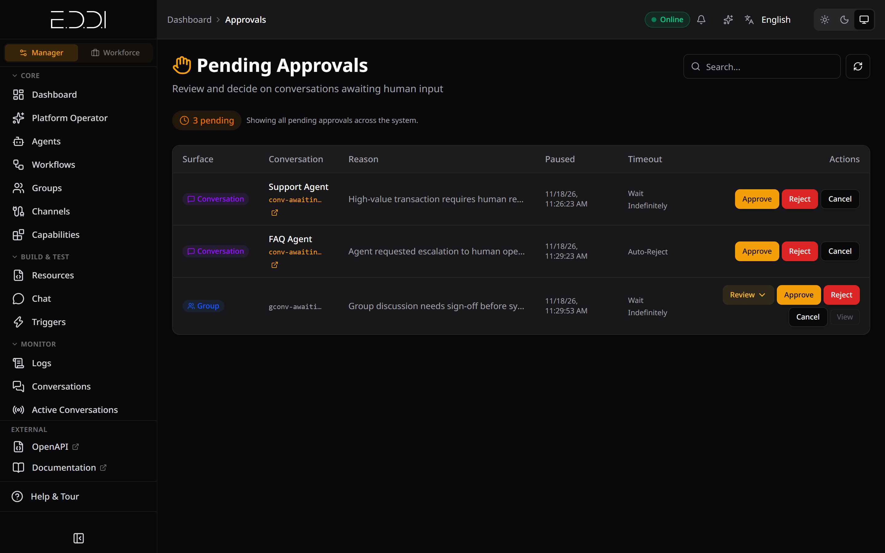
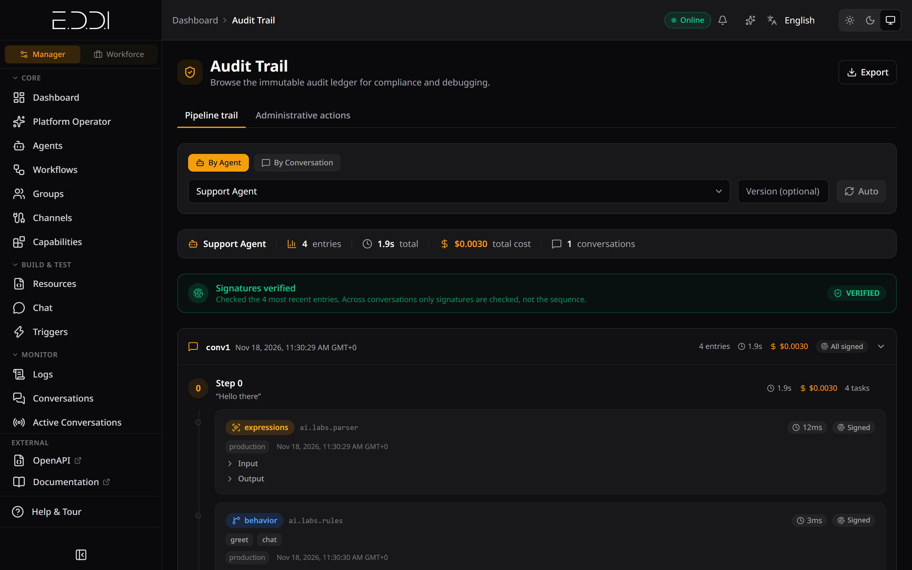

<p align="center">
  
</p>

# EDDI

[](https://www.bestpractices.dev/projects/12355) [](https://securityscorecards.dev/viewer/?uri=github.com/labsai/EDDI) [](https://app.codacy.com/organizations/gh/labsai/dashboard?utm_source=github.com&utm_medium=referral&utm_content=labsai/EDDI&utm_campaign=Badge_Grade)

[](https://github.com/labsai/EDDI/actions/workflows/ci.yml) [](https://github.com/labsai/EDDI/actions/workflows/codeql.yml)  

[](https://hub.docker.com/r/labsai/eddi) [](https://github.com/labsai/EDDI/releases) [](LICENSE) [](AGENTS.md)

**The open-source AI agent management system.** Run teams of AI agents on your own infrastructure, limit what they may do, put a person in front of the decisions that matter, and keep a record of every step.

EDDI (E.D.D.I, Enhanced Dialog Driven Interface) is a server you run between your users, your LLMs and your business systems. An agent is a set of versioned JSON configurations, not application code: which model it uses, its prompt, its tools and knowledge, what it remembers, and what needs a human's approval. One Docker image serves the REST API, the admin dashboard and the chat UIs. It is Apache-2.0 licensed, every image is checked against Red Hat's container certification requirements, and EDDI was selected as a UNIDO Trusted Partner for Industrial AI.

[Website](https://eddi.technology/) · [Documentation](https://docs.labs.ai/) · [Quick start](#quick-start) · [Docker Hub](https://hub.docker.com/r/labsai/eddi) · [Discussions](https://github.com/labsai/EDDI/discussions)

## Why EDDI

EDDI is built around the four things you need before an agent is allowed to act:

- **Run.** Agents work alone or [as a team](docs/group-conversations.md), with any of 19 model providers, local models included, on your own servers. It installs with one Docker command or on Kubernetes and OpenShift, on MongoDB or PostgreSQL.
- **Limit.** An agent holds only the tools its configuration grants, within rate limits and cost budgets. Agents cannot run arbitrary code: there is no `eval` and no script engine, and custom logic runs in external MCP servers. Secrets sit in an envelope-encrypted [vault](docs/secrets-vault.md).
- **Approve.** Whole turns, single tool calls or phases of a group discussion can [wait for a person](docs/hitl.md), in the Manager, in Slack or over MCP.
- **Record.** Every step lands in an append-only [audit ledger](docs/audit-ledger.md), HMAC-signed once a signing key is configured. GDPR/CCPA erasure and export are built in, and there are deployment guides (guides, not certifications) for HIPAA and the EU AI Act.

Two design choices make that practical:

- **Agents are configuration.** Models, prompts, tools, API calls and knowledge bases are versioned JSON documents. Change an agent without rebuilding or restarting EDDI, diff it, export it as a ZIP, or sync it to another instance.
- **Open protocols.** EDDI is an [MCP](docs/mcp-server.md) server (120 tools) and an MCP client, speaks [A2A](docs/a2a-protocol.md), and can serve deployed agents through an [OpenAI-compatible `/v1` API](docs/open-webui-integration.md) (off by default).

EDDI is a service you deploy, not a library you import. If you want agent logic inside your own Java application, a library such as [LangChain4j](https://github.com/langchain4j/langchain4j), which EDDI itself builds on, is the closer fit. The [project philosophy](docs/project-philosophy.md) explains the design: "the engine is strict so the AI can be creative."

## Works with the AI you already use

EDDI does not replace ChatGPT, Claude or the assistant in your IDE. It gives them somewhere governed to work.

Everything in EDDI can be set up and inspected by hand in the Manager. The better experience is to connect the assistant you already use, over [MCP](docs/mcp-server.md#quick-start) or the REST API, and let it do the work:

- **It builds and runs agents for you.** Ask Claude, Cursor or any other MCP-capable assistant, including one running locally, to create an agent, test it, read its logs or change its prompt. Every change is a new version in EDDI, and the ones you gate wait for your approval.
- **It consults agents that can reach what it cannot.** An EDDI agent can hold a connection to a database, an internal API or a knowledge base that your personal assistant has no access to. Your assistant asks the agent, or a whole group of agents, and works with the answer. The credentials stay in EDDI's vault and the exchange lands in the audit ledger.
- **It collaborates across systems.** Other agent platforms reach EDDI agents the same way, over [A2A](docs/a2a-protocol.md) or the [OpenAI-compatible API](docs/open-webui-integration.md).

EDDI also stands on its own. End users can talk to agents and teams of agents directly in [Workforce](docs/workforce-guide.md), in the embeddable [chat UI](docs/chat-ui-embedding.md), or in Slack. For Claude Code there is a [plugin](integrations/claude-plugin/README.md) with ready-made skills.

## Quick start

You need [Docker](https://docs.docker.com/get-docker/) on an x86-64 host, and a model for your agents: an API key for a hosted provider, or [Ollama](docs/docker.md#compose-files-and-overlays) for a local one. The installer asks which database, authentication and monitoring you want, generates a vault key, and starts everything with Docker Compose.

**Linux / macOS / WSL2**

```bash
curl -fsSL https://raw.githubusercontent.com/labsai/EDDI/main/install.sh | bash
```

**Windows (PowerShell)**

```powershell
Invoke-WebRequest -UseBasicParsing -Uri "https://raw.githubusercontent.com/labsai/EDDI/main/install.ps1" -OutFile "install.ps1"
Unblock-File .\install.ps1
.\install.ps1
```

Then open <http://localhost:7070>, which offers a choice between the Manager and Workforce. Everything is served from that one port:

| Path | What it is |
| --- | --- |
| `/manage` | The Manager: the admin dashboard for building, testing, deploying and monitoring agents |
| `/workforce` | Workforce: the end-user app for chats with agents and teams of agents |
| `/chat` | The standalone chat UI |
| `/q/swagger-ui` | The REST API |

A fresh install has no agents. To get to a first reply:

1. Check the install: `curl http://localhost:7070/q/health/ready` answers `"status":"UP"`.
2. Store your model key in the vault, under **Secrets** in the Manager (`/manage/secrets`).
3. Create an agent with the wizard at `/manage/agents/wizard`, or activate the **Platform Operator** at `/manage/operator` and describe the agent you want. The Operator is an agent too, so it needs a model before it can help.
4. Chat with the agent in the Manager. The wizard deploys to the `test` environment; an agent appears for end users in Workforce once it is deployed to production and [listed in the catalog](docs/catalog.md).

By default the install has no login and is published on `127.0.0.1` only, which suits a laptop. For anything other people can reach, turn authentication on: `install.sh --with-auth` (`install.ps1 -WithAuth`) adds Keycloak.

Other ways in:

- **Read the script first, or pass options:** [`install.sh`](install.sh) and [`install.ps1`](install.ps1); flags, updating with `eddi update` and uninstalling are in [Getting Started](docs/getting-started.md#installer-options).
- **Docker Compose by hand:** clone the repository and run `docker compose up`. Set `EDDI_VAULT_MASTER_KEY` first, or the secrets vault stays disabled. The PostgreSQL, Keycloak, monitoring, Ollama and cluster stacks are in the [Docker guide](docs/docker.md#compose-files-and-overlays).
- **Kubernetes or OpenShift:** Kustomize overlays and a Helm chart, in the [Kubernetes guide](docs/kubernetes.md).
- **Upgrading an existing deployment:** read the upgrade guide for your version first ([from 6.5](docs/upgrading-from-6.5.md), [from 6.4](docs/upgrading-from-6.4.md), [from 5.x](docs/upgrading-from-5x.md)). Several defaults now fail closed.
- **From source:** see [Development](#development).

## What it looks like

<p align="center">
  <a href="screenshots/manager-group-discussion.png"></a>
</p>

<p align="center"><em>Run: a team of agents working a question through, with shared artifacts</em></p>

<table>
<tr>
<td width="50%"><a href="screenshots/manager-approvals.png"></a></td>
<td width="50%"><a href="screenshots/manager-audit-trail.png"></a></td>
</tr>
<tr>
<td align="center"><em>Approve: actions that wait for a person, in one list</em></td>
<td align="center"><em>Record: every step of a turn, signed, with its duration and cost</em></td>
</tr>
</table>

The [Manager guide](docs/agent-manager-gui.md) and the [Workforce guide](docs/workforce-guide.md) tour the rest.

## How it works

The heart of an agent is its LLM step: the model, its prompt, and what it may use. This one answers every message with Claude and may call three of the built-in tools:

```json
{
  "tasks": [
    {
      "actions": ["*"],
      "id": "aiAgent",
      "type": "anthropic",
      "description": "AI agent with calculator, date and web search",
      "parameters": {
        "apiKey": "${vault:anthropic-key}",
        "modelName": "claude-sonnet-5-5",
        "systemMessage": "You are a helpful assistant with access to tools."
      },
      "enableBuiltInTools": true,
      "builtInToolsWhitelist": ["calculator", "datetime", "websearch"],
      "conversationHistoryLimit": 10
    }
  ]
}
```

- `actions` says when the step runs; `*` means on every message.
- `type` and `modelName` pick the model. Any of the other providers works the same way (`openai`, `gemini`, `bedrock`, `ollama` and more).
- `apiKey` is a reference into the secrets vault, never the key itself.

This document is one step of a workflow, and an agent is a list of workflows. It is also where you add your own REST APIs and MCP servers as tools, a knowledge base, model cascading and approval gates; [LLM configuration](docs/langchain.md) lists every field.

You rarely write it by hand. The Manager's wizard, the Platform Operator and the MCP server (from Claude Desktop, Cursor or any other MCP client) create and change agents for you, and every save is a new version you can diff and export.

Underneath, each message runs through a pipeline of steps that share the conversation's memory: parse the input, call APIs and the model, produce the output. Where a step must not be left to a model, such as a fixed reply or a mandatory check, deterministic [behavior rules](docs/behavior-rules.md) can decide it instead. [Architecture](docs/architecture.md) explains the engine, and the [Developer Quickstart](docs/developer-quickstart.md) builds an agent step by step over the REST API.

## What's included

| Area | What you get | Read more |
| --- | --- | --- |
| 🤖 **Multi-agent** | Group conversations in 7 preset discussion styles, with voting, shared artifacts, humans as members and standing teams; intent-routed managed conversations; capability matching | [Groups](docs/group-conversations.md) · [Managed agents](docs/managed-agents.md) · [Capabilities](docs/capability-match-guide.md) |
| 🧠 **LLMs** | 19 providers, among them OpenAI, Anthropic, Gemini, Mistral, Azure OpenAI, Bedrock, Vertex AI and Ollama, plus any OpenAI-compatible endpoint; tool calling; cost-aware model cascading | [LLM configuration](docs/langchain.md) · [Model cascading](docs/model-cascade.md) |
| 💭 **Memory** | Persistent user memory across conversations, background consolidation, token-aware windowing, rolling summaries with recall | [User memory](docs/user-memory.md) · [Conversation memory](docs/conversation-memory.md) |
| 📚 **RAG** | 8 embedding providers, 6 vector stores, a web crawler, file uploads and scheduled ingestion | [RAG](docs/rag.md) |
| 🛠️ **Tools** | Built-in tools (web search, calculator, web scraper, PDF reader and more), your own REST APIs as tools, external MCP servers, multimodal attachments | [HTTP calls](docs/httpcalls.md) · [MCP client](docs/mcp-client.md) · [Attachments](docs/attachments-guide.md) |
| 🔗 **Protocols** | MCP server, A2A, an OpenAI-compatible API, SSE streaming, Slack | [MCP server](docs/mcp-server.md) · [A2A](docs/a2a-protocol.md) · [OpenAI-compatible API](docs/open-webui-integration.md) · [Slack](docs/slack-integration.md) |
| ✋ **Human-in-the-loop** | Approval gates per turn, per tool call and per group phase, with timeout policies; resolved from the Manager, Slack or MCP | [HITL](docs/hitl.md) |
| 🔐 **Security** | Secrets vault, one credential model including per-user OAuth, SSRF-protected tools, Keycloak/OIDC, workspaces and sharing, optional agent signing | [Security](docs/security.md) · [Secrets vault](docs/secrets-vault.md) · [Connections](docs/connections.md) · [Workspaces](docs/workspaces.md) |
| 📋 **Compliance** | Audit ledger, GDPR/CCPA erasure and export, HIPAA and EU AI Act guides | [Audit ledger](docs/audit-ledger.md) · [GDPR](docs/gdpr-compliance.md) · [HIPAA](docs/hipaa-compliance.md) · [EU AI Act](docs/eu-ai-act-compliance.md) · [Privacy](PRIVACY.md) |
| 🚀 **Operations** | Cron schedules and heartbeats, tenant quotas and cost budgets, Prometheus metrics with a Grafana dashboard, OpenTelemetry traces, clustering | [Scheduling](docs/scheduling.md) · [Quotas](docs/tenant-quotas.md) · [Monitoring](docs/monitoring/monitoring-guide.md) · [Clustering](docs/clustering.md) |
| 🖥️ **UIs** | The Manager (in 11 languages), Workforce and a standalone chat UI, all inside the same image | [Manager](docs/agent-manager-gui.md) · [Workforce](docs/workforce-guide.md) · [Chat UI](docs/chat-ui-embedding.md) |

The complete list, feature by feature, is [at the end of this page](#full-feature-list).

## Documentation

| If you want to | Start with |
| --- | --- |
| Install EDDI and check that it works | [Getting Started](docs/getting-started.md) |
| Build an agent step by step | [Developer Quickstart](docs/developer-quickstart.md) · [Putting It All Together](docs/putting-it-all-together.md) |
| Write agent configurations | [Agent Config Authoring](docs/agent-config-authoring.md) · [Behavior Rules](docs/behavior-rules.md) |
| Run it in production | [Docker](docs/docker.md) · [Kubernetes](docs/kubernetes.md) · [Red Hat and OpenShift](docs/redhat-openshift.md) · [Configuration Reference](docs/configuration-reference.md) |
| Upgrade an existing deployment | [From 6.5](docs/upgrading-from-6.5.md) · [From 6.4](docs/upgrading-from-6.4.md) · [From 5.x](docs/upgrading-from-5x.md) |
| Fix something | [Troubleshooting](docs/troubleshooting.md) |
| Understand the design | [Architecture](docs/architecture.md) · [Project Philosophy](docs/project-philosophy.md) |

Everything else is at [docs.labs.ai](https://docs.labs.ai/), built from [`docs/`](docs/README.md) in this repository.

## Development

EDDI is Java 25 on Quarkus. You need JDK 25 and Docker; Maven comes with the wrapper, and Node is downloaded by the build when it is needed. On Windows, use `.\mvnw.cmd` in place of `./mvnw`.

```bash
docker run -d -p 27017:27017 mongo:7

# Dev mode with live reload: http://localhost:7070, Dev UI at /q/dev-ui
./mvnw compile quarkus:dev '-Djvm.args=--add-modules=jdk.incubator.vector'

./mvnw test                     # unit tests
./mvnw verify -DskipITs=false   # everything CI runs, integration tests included (needs Docker)
```

The `-Djvm.args` flag gives in-process `jlama` agents the Vector API that the container image enables; drop it if you never run one.

Dev mode does not build the web UIs, so `/manage` and `/workforce` answer there only after a `./mvnw package`. For frontend work, run `npm ci` once in `ui/`, then `npm run dev` in the app's directory.

| Path | Contents |
| --- | --- |
| [`src/`](src/) | The backend: engine, REST API, MCP server |
| [`ui/manager`](ui/manager/) · [`ui/workforce`](ui/workforce/) · [`ui/chat`](ui/chat/) | The three web UIs (React, Vite, TypeScript), built into the jar by Maven |
| [`docs/`](docs/README.md) · [`docs-site/`](docs-site/README.md) | The documentation and the site that publishes it |
| [`helm/`](helm/) · [`k8s/`](k8s/) | The Helm chart and the Kustomize overlays |
| [`integrations/claude-plugin`](integrations/claude-plugin/README.md) | Claude Code skills for operating EDDI through its MCP server |

The full command list, code style and the pull-request process are in [CONTRIBUTING.md](CONTRIBUTING.md#maven-command-reference). AI coding assistants read [AGENTS.md](AGENTS.md). For Quarkus applications, [quarkus-eddi](https://github.com/quarkiverse/quarkus-eddi) is the client SDK.

## Community and support

- **Questions and ideas:** [GitHub Discussions](https://github.com/labsai/EDDI/discussions)
- **Bugs and feature requests:** [GitHub Issues](https://github.com/labsai/EDDI/issues)
- **Contributing:** [CONTRIBUTING.md](CONTRIBUTING.md), [Code of Conduct](CODE_OF_CONDUCT.md) and [Governance](GOVERNANCE.md)
- **Security:** report vulnerabilities privately as the [Security Policy](SECURITY.md) describes. The container image refuses to start without authentication unless you opt out; the bundled Compose files opt out for local use and publish on `127.0.0.1` only. The details are in the [security guide](docs/security.md).

## Full feature list

Everything in one place, for reading or searching without leaving the page. Each area links to its guide.

### 🤖 Multi-agent orchestration

[Group conversations](docs/group-conversations.md) · [Managed agents](docs/managed-agents.md) · [Capability matching](docs/capability-match-guide.md)

- **Group conversations:** agents discuss a question in one of 7 preset styles: Round Table, Peer Review, Devil's Advocate, Delphi, Debate, Task Force and Negotiation.
- **Follow-up and continue:** ask one member a follow-up, or run all phases again with a new question. Members keep their context.
- **Nested groups:** groups of groups, for tournament brackets, red team against blue team, and panel reviews.
- **Dynamic agents:** create, recruit and delegate to new agents during a discussion, within configured guardrails.
- **Voting:** `VOTE` phases collect ballots (majority or approval, weighted, with a quorum) and record the tally and the dissents.
- **Shared artifacts:** a blackboard that members edit through tools, with compare-and-set concurrency and declarative validators.
- **Humans as members:** a person can hold a seat. Their turn pauses the discussion until they answer or a timeout policy resolves it.
- **Facilitator:** an optional agent that picks one move from a configured list at checkpoints: end, extend, call a vote, recruit or escalate.
- **Negotiation:** two-party bargaining with positions, proposals, a concession ledger and signed acceptances.
- **Bid-based assignment:** members bid for a task blind and in parallel, and the highest confidence wins.
- **Team memory:** a `RETRO` phase turns lessons into group memory that later discussions see.
- **Standing teams:** a persistent workspace per group with a backlog, cron cadences, retries and team metrics.
- **Group templates:** five packaged group configurations that you fill by assigning agents to roles.
- **Discussion overview:** a live phase rail, a members by phases matrix, and one-line member stances.
- **Managed conversations:** intent-based routing, with one conversation per user per intent.
- **Capability matching:** find and route to agents by skill, confidence and custom attributes.
- **Platform Operator:** an agent that inspects and operates the deployment, including creating other agents. Every write waits for a human's approval.
- **Agent version following:** running conversations move to a new agent version only when its author marked it compatible.

### 🧠 LLM providers

[LLM configuration](docs/langchain.md) · [Model cascading](docs/model-cascade.md)

| Category | Providers |
| --- | --- |
| Cloud APIs | OpenAI · Anthropic Claude · Google Gemini · Mistral AI |
| Enterprise cloud | Azure OpenAI · Amazon Bedrock · Oracle GenAI · Google Vertex AI |
| Self-hosted | Ollama · Jlama · Hugging Face |
| OpenAI-compatible | xAI Grok · DeepSeek · Moonshot Kimi · Alibaba Qwen · Z.ai GLM · MiniMax · OpenRouter · Groq |
| Any endpoint | Anything else that is OpenAI-compatible, through `baseUrl` |

- **Tool calling:** native function calling on every provider that supports it.
- **Model cascading:** try a cheap, fast model first and escalate when confidence is low. Four confidence strategies.
- **JSON response mode:** `jsonResponseFormat` (`auto`, `on`, `off`) negotiates structured output per provider.
- **Tool result caching:** per-tool cache scope (`GLOBAL`, `USER`, `CONVERSATION`) to avoid repeated calls.
- **Budgets:** cost tracking and caps per conversation, and monthly cost ceilings per tenant.

### 🔗 Standards and interoperability

| Standard | Role | What it gives you |
| --- | --- | --- |
| [MCP](docs/mcp-server.md) | Server (120 tools) and [client](docs/mcp-client.md) | Operate EDDI from Claude Desktop, Cursor or any MCP client, and connect agents to external MCP tool servers |
| [A2A](docs/a2a-protocol.md) | Full implementation | Agent-to-agent communication across platforms, Agent Cards and skill discovery |
| OpenAPI 3.1 | Generation and consumption | A generated spec for EDDI, and an API-calling agent from any OpenAPI spec you paste |
| OAuth 2.0 / OIDC | Keycloak integration | Authentication and authorization. [Connections](docs/connections.md) give agents per-user OAuth grants to external systems |
| [OpenAI Chat Completions](docs/open-webui-integration.md) | Server at `/v1`, off by default | Deployed agents appear as OpenAI models to Open WebUI, the `openai` SDK and other compatible clients |
| SSE | Streaming | Token-by-token replies, live tool-call status, group discussion feeds and log streaming |
| [Slack](docs/slack-integration.md) | Channel | Agents in Slack channels, group discussions in threads, approvals as interactive cards |

### 💭 Memory and context

[User memory](docs/user-memory.md) · [Conversation memory](docs/conversation-memory.md) · [Memory policy](docs/memory-policy.md)

- **Persistent user memory:** facts and preferences that survive across conversations, scoped to `self`, `group` or `global`.
- **Memory tools:** agents can read, write and search their own memory, limited to their own entries unless configured otherwise.
- **Dream consolidation:** background maintenance that prunes stale entries, detects contradictions and summarizes.
- **Token-aware windowing:** the model's context is packed by token count, with the opening steps anchored.
- **Rolling summary:** older turns are summarized incrementally, and a recall tool reaches back into them.
- **Property extraction:** config-driven slot filling with `longTerm`, `conversation`, `step` and `secret` scopes.
- **Memory policy:** output of a failed task is marked uncommitted and hidden from the model.
- **Tool context ceiling:** `maxToolContextTokens` caps tool output within a turn (60k tokens by default).
- **Conversation state:** full history with undo and redo.

### 📚 RAG

[RAG guide](docs/rag.md)

- **8 embedding providers:** OpenAI, Azure OpenAI, Ollama, Mistral, Bedrock, Cohere, Google Gemini and Vertex AI.
- **6 vector stores:** pgvector, Chroma, in-memory, MongoDB Atlas, Elasticsearch and Qdrant.
- **Web crawler:** follows robots rules and sitemaps, bounded by depth, page count and time.
- **File uploads:** PDF, Word, Excel, PowerPoint, CSV, HTML, Markdown and text.
- **Scheduled ingestion:** each source runs on its own cron or on demand, with a run history.
- **httpCall RAG:** retrieval through any search API, with no vector infrastructure.
- **Ingestion API:** asynchronous document ingestion over REST, with status tracking.

### 🛠️ Built-in tools

| Tool | What it does |
| --- | --- |
| Web search | DuckDuckGo instant answers, Brave Search API, or Google Custom Search (until 2027-01-01) |
| Calculator | A recursive-descent math parser with no `eval` |
| Web scraper | Size-capped extraction of web pages as Markdown |
| PDF reader | Document text extraction |
| Weather, date and time | Real-time data |
| Data formatter, text summarizer | Data transformation |
| [HTTP calls](docs/httpcalls.md) | Your own REST APIs as tools the model can call |
| User memory, conversation recall | Reading and writing memory, and reaching into summarized history |
| [Attachments](docs/attachments-guide.md) | Image, PDF, audio and video input, routed by MIME type |

### 📎 Attachments

- **Three input paths:** a URL, inline base64, or a file upload.
- **Storage:** GridFS on MongoDB or bytea on PostgreSQL, with grant-based access and tenant quotas.
- **PDF extraction:** PDF text is extracted and passed to any model, not only vision models.
- **Capability gating:** images go to vision-capable models, and other models get text metadata.
- **Content-type routing:** a behavior rule condition routes by MIME type.
- **Groups:** attachments reach every member of a group discussion.

### ⏰ Scheduling

[Scheduling guide](docs/scheduling.md)

- **Cron schedules and heartbeats:** timed and periodic agent runs.
- **Conversation strategy:** reuse one conversation across runs, or start fresh each time.
- **Fire log:** status, duration, cost and retries for every run.

### ✋ Human-in-the-loop

[HITL guide](docs/hitl.md)

- **Turn approval:** `PAUSE_CONVERSATION` halts a turn until a human resumes it.
- **Tool-call approval:** individual tool calls can wait for approval, selected by glob pattern.
- **Group phase approval:** discussion phases can need sign-off per phase or per task.
- **Timeout policies:** wait indefinitely, approve, reject or abort.
- **Where you approve:** the Manager, Slack cards, or MCP tools.
- **Recovery:** pending approvals survive a restart.

### 🔐 Security

[Security guide](docs/security.md) · [Secrets vault](docs/secrets-vault.md) · [Connections](docs/connections.md) · [Workspaces](docs/workspaces.md)

- **Secrets vault:** envelope encryption (PBKDF2 and AES-256-GCM) with key rotation. Each secret names the agents allowed to use it.
- **Connections:** one credential model for outbound calls, resolving to an org-wide key or the end user's own OAuth grant.
- **Caller identity:** an HTTP call can act as the signed-in user with `${caller:token}`.
- **SSRF protection:** the built-in tools refuse private addresses, internal hostnames and non-HTTP schemes.
- **No dynamic code execution:** no `eval` and no script engines. Custom logic runs in external MCP servers.
- **Authentication:** OAuth 2.0 with Keycloak, role-based access, and enforced token audience.
- **Workspaces and sharing:** opt-in per-user and per-team spaces with `USE`, `VIEW`, `EDIT` and `OWN` shares.
- **Restricted templates:** runtime templates run in a locked-down engine, and fetched data is never rendered as a template.
- **Agent signing:** optionally, an Ed25519 identity per agent that signs its messages and audit entries.

### 📋 Compliance

[Audit ledger](docs/audit-ledger.md) · [GDPR / CCPA](docs/gdpr-compliance.md) · [HIPAA](docs/hipaa-compliance.md) · [EU AI Act](docs/eu-ai-act-compliance.md) · [Privacy](PRIVACY.md) · [Incident response](docs/incident-response.md)

| Regulation | What EDDI provides |
| --- | --- |
| EU AI Act | An append-only audit ledger (HMAC-signed once a key is configured), decision traceability, and risk classification guidance |
| GDPR | Cascading erasure (Art. 17), portability (Art. 15/20), restriction of processing (Art. 18), per-category retention and pseudonymization |
| CCPA | Right to delete, right to know, and data portability |
| HIPAA | A deployment guide, a BAA template and an LLM provider BAA matrix |
| International | PIPEDA, LGPD, APPI, POPIA, PDPA and PIPL compatibility documented |

### ⚙️ Configuration

[Architecture](docs/architecture.md) · [Agent config authoring](docs/agent-config-authoring.md)

- **JSON, not code:** agent behavior lives in versioned documents you can diff.
- **Composable agents:** agents are assembled from reusable workflows and extensions.
- **Behavior rules:** optional IF-THEN logic for the steps that must be deterministic.
- **Import and export:** agents as ZIP files, with secrets scrubbed on export.
- **Agent sync:** live sync between instances, with diffing and selective picking.
- **Prompt snippets and global variables:** reusable prompt blocks and deployment-wide values.

### 🚀 Operations

[Docker](docs/docker.md) · [Kubernetes](docs/kubernetes.md) · [Clustering](docs/clustering.md) · [Monitoring](docs/monitoring/monitoring-guide.md) · [Red Hat and OpenShift](docs/redhat-openshift.md)

- **One-command install:** an interactive installer sets up EDDI and a database with Docker.
- **Kubernetes and OpenShift:** Kustomize overlays and a Helm chart.
- **Horizontal scaling:** any number of replicas behind a load balancer, coordinated through NATS JetStream.
- **Metrics:** Micrometer metrics for tools, vault, memory, scheduling and conversations at `/q/metrics`, and a ready-made Grafana dashboard.
- **Tracing:** an OpenTelemetry span per pipeline task and per model call.
- **Health checks:** liveness and readiness probes.
- **Recovery:** retries with backoff, MCP circuit breakers and model response validation.
- **Database choice:** MongoDB or PostgreSQL from the same image.
- **Red Hat certification:** every image is checked against Red Hat's container certification requirements in CI, and each stable release is submitted for certification.

### 🖥️ User interfaces

[Manager](docs/agent-manager-gui.md) · [Workforce](docs/workforce-guide.md) · [Chat UI](docs/chat-ui-embedding.md)

- **Manager** at `/manage`: build, test, deploy and monitor agents, with the Platform Operator and an agent wizard.
- **Workforce** at `/workforce`: the end-user app for chats with agents and teams of agents.
- **Chat UI** at `/chat`: a standalone chat with streaming.
- **Also in the Manager:** approvals, connections, sharing, an audit trail viewer, live logs and a secrets manager.
- **11 languages:** English, German, Spanish, French, Portuguese, Chinese, Japanese, Korean, Arabic, Hindi and Thai.

## License

[Apache License 2.0](LICENSE)
